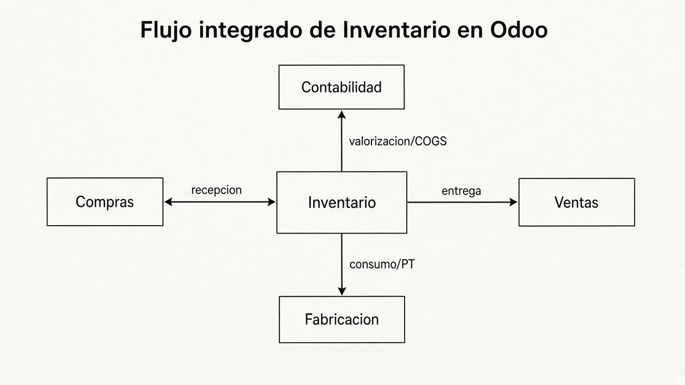
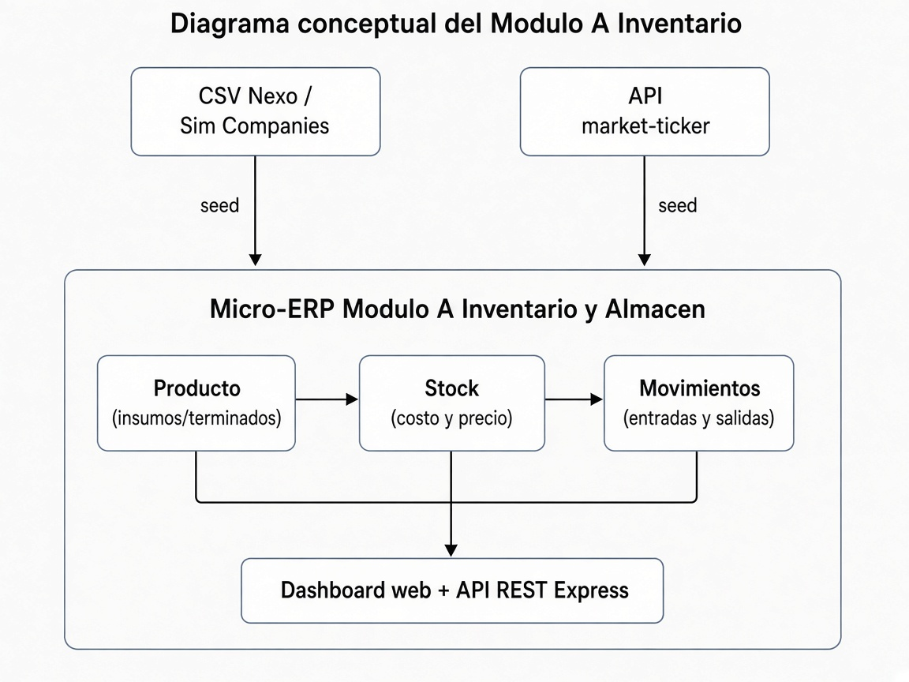

# Fase I. Investigación del ERP comercial

**Práctica:** Investigación y Desarrollo de un Micro-ERP Modular  
**ERP analizado:** Odoo  
**Módulo a construir:** Inventario y Almacén (Módulo A · Sim Companies)  
**Proyecto:** Almacén SimCo  

---

## ¿Qué es Odoo?

Odoo es un **ERP** (Enterprise Resource Planning): un software que junta en un solo sistema las piezas típicas de una empresa —ventas, compras, inventario, contabilidad, fabricación, RR.HH., etc.— para que no vivan en hojas de cálculo sueltas.

Nació como proyecto open source (antes se llamaba OpenERP) y hoy tiene dos caminos:

- **Community:** gratis, código abierto, suficiente para entender la arquitectura y operar módulos básicos.
- **Enterprise:** de pago, con más apps, soporte y funciones extra.

Se usa sobre todo en pymes y empresas medianas que quieren algo más flexible (y a veces más barato) que SAP o Oracle, pero con la misma idea de “todo conectado”. Corre en la nube (Odoo Online / Odoo.sh) o instalado en servidores propios. Su base de datos es PostgreSQL y su lógica está organizada en **aplicaciones instalables**: no tienes que encender todo el ERP de golpe.

En resumen: Odoo sirve para **centralizar la operación** de una empresa. Un pedido de venta puede disparar una entrega de inventario, esa entrega baja stock y Contabilidad registra el impacto, sin volver a capturar los mismos datos en tres sistemas distintos.

Para esta práctica conviene porque:

1. Es uno de los ERP que sugiere el enunciado.
2. Su modelo modular se parece a elegir solo el Módulo A, B, C o D.
3. El módulo de Inventario está bien documentado y es fácil de contrastar con lo que vamos a simplificar.

---

## 1. Mapeo de módulos principales

Odoo no se vende como un bloque cerrado. Se instalan apps según lo que necesite la empresa, todas sobre la misma base de datos:

| Módulo | Para qué sirve |
|--------|----------------|
| Inventario | Existencias, ubicaciones, traslados, reorden |
| Compras | Proveedores, órdenes de compra y recepción |
| Ventas | Pedidos, entrega y facturación |
| Contabilidad | Asientos que salen de movimientos y facturas |
| Fabricación | Listas de materiales y órdenes de producción |
| CRM | Seguimiento de oportunidades comerciales |
| RR.HH. | Empleados, contratos y nómina (según edición) |

Para el Micro-ERP nos quedamos con **Inventario**, que es el **Módulo A** del requerimiento.

---

## 2. Flujo de datos integrado

En Odoo el almacén casi nunca trabaja solo. Una compra termina en recepción y mueve stock; una venta termina en entrega y baja existencias; Contabilidad toma esos movimientos para valuación o costo de venta. Fabricación consume insumos y regresa producto terminado al mismo inventario.

*Figura 1. Inventario como hub entre Compras, Ventas, Fabricación y Contabilidad.*

En corto:

- **Compras → Inventario:** entra mercancía y queda el costo.
- **Inventario → Ventas:** sale mercancía al entregar el pedido.
- **Inventario → Contabilidad:** el movimiento impacta valuación / COGS.
- **Fabricación ↔ Inventario:** salen insumos y entra producto terminado.

El producto (SKU) es el mismo en todas las apps; cambia el uso que cada módulo le da.

---

## 3. Análisis comparativo: qué se simplifica

Un Odoo de producción trae ubicaciones, lotes, reservas, reorden automático y asientos contables. El Micro-ERP no copia eso. Nos quedamos con lo que pide el Módulo A:

| En Odoo | En Almacén SimCo |
|---------|------------------|
| Varios almacenes y picking | Una sola cantidad de stock |
| Lotes / series | No aplica |
| Reorden automático | Aviso de stock bajo en el dashboard |
| Contabilidad automática | Solo costo y precio de mercado |
| WMS / códigos de barras | Formulario web y movimientos a mano |
| Proveedores y clientes | Quedan para los módulos B y C |

Sí mantenemos: catálogo de insumos y terminados, stock, costo, precio sugerido de mercado, historial de entradas (producción/compra) y salidas (venta/descarte), y un dashboard. Los datos vienen de Sim Companies (export Nexo + API de precios), no de un Excel inventado.

---

## 4. Diagrama conceptual del módulo a replicar

Esquema del entregable: de dónde entran los datos y qué piezas tiene el Micro-ERP de Inventario.

*Figura 2. Sim Companies → Producto / Stock / Movimientos → Dashboard y API REST.*

Lectura directa: CSV Nexo y `market-ticker` alimentan el seed; adentro quedan Producto, Stock y Movimientos; sobre eso corren el dashboard y Express. Frente a Odoo, es solo el núcleo del almacén.

---

## 5. Cierre

Odoo es un ERP modular pensado para centralizar la operación de una empresa. Su módulo de Inventario conecta compras, ventas, producción y contabilidad. En Almacén SimCo se reduce ese núcleo —productos, stock, movimientos y precios— con el stack de la práctica (Node/Express, SQLite, HTML/JS) y datos del simulador Sim Companies. El resto de apps de Odoo se dejan fuera a propósito.
